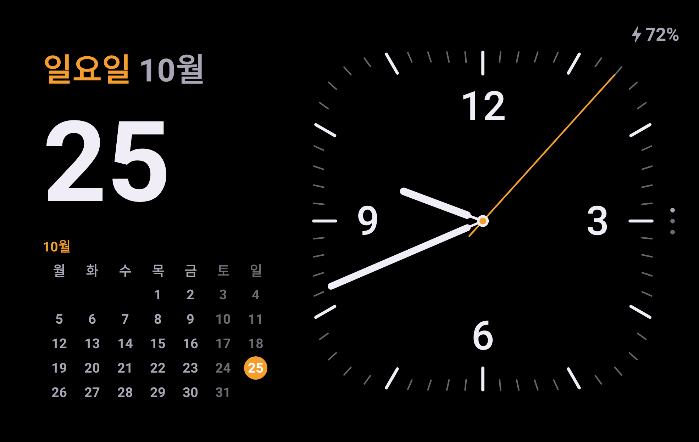
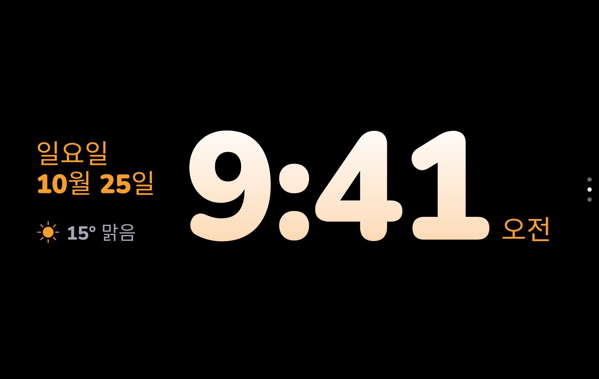
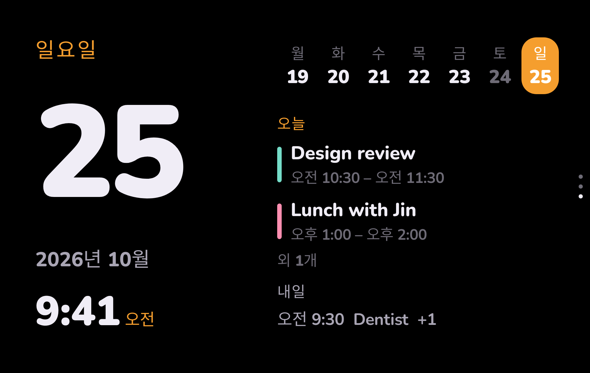
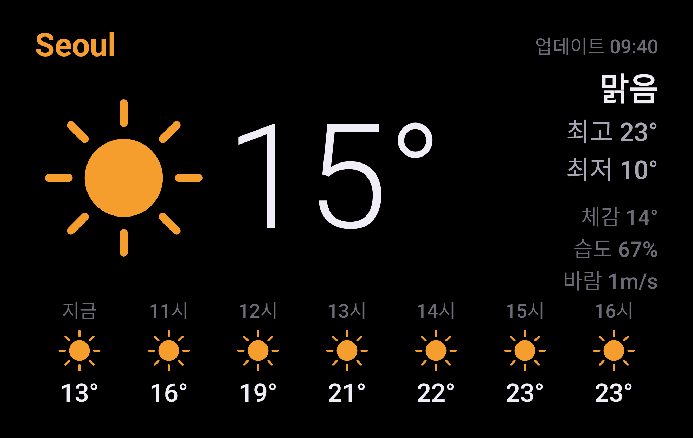
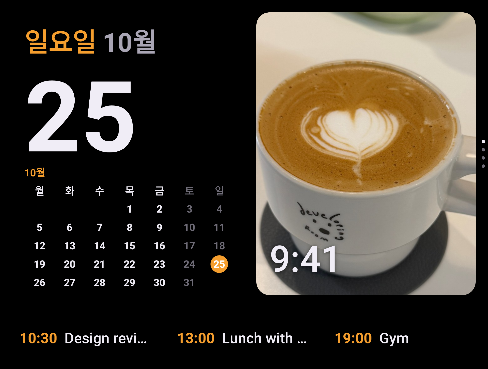
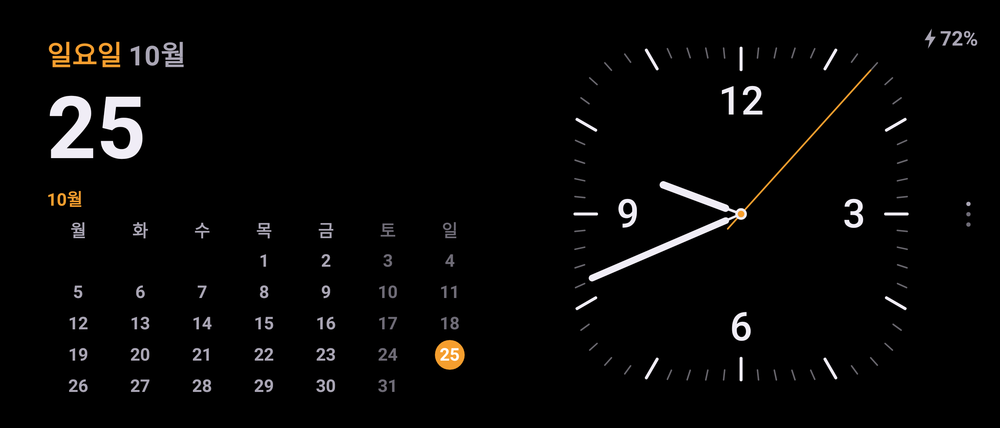
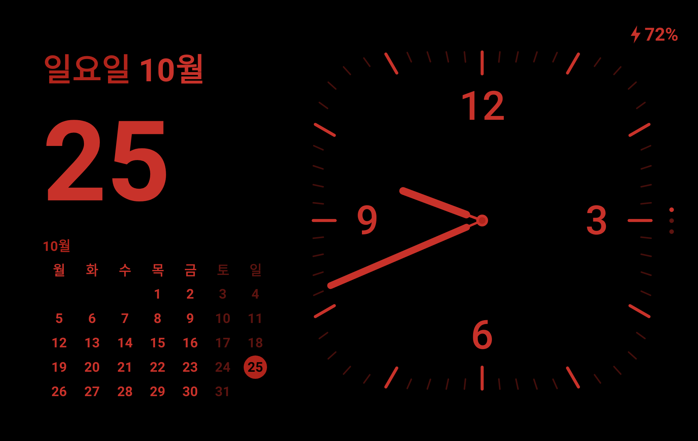
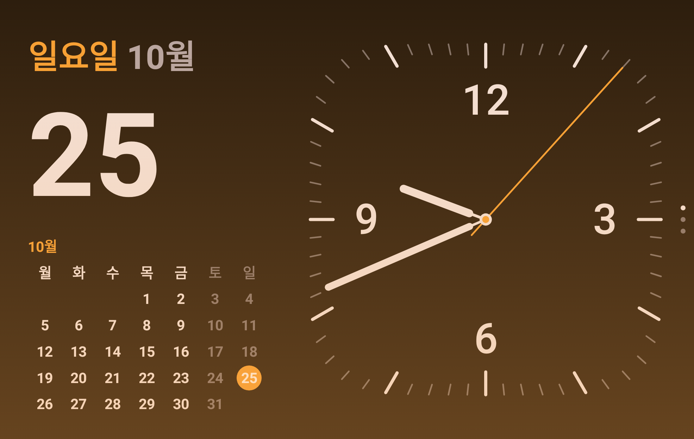
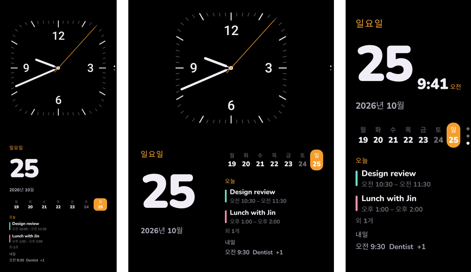

# Standface

갤럭시 폰을 충전기에 세워 두면 아이폰 스탠바이처럼 시계·달력·날씨·음악·사진을 크게 보여주는 앱이에요. 침대 옆에서도, 책상 위에서도 써요. 폴드와 플립은 반쯤 접어 세운 자세에도 맞춰 보여줘요.

> [!WARNING]
> 화면을 몇 시간씩 켜 두는 앱이라 **번인(화면에 남는 자국)이 생길 수 있어요.** 특히 밝은 방에서 오래 켜 두면 위험해요. 쓰기 전에 [번인 주의](#번인-주의)를 꼭 읽어 주세요.

- 플레이 스토어에는 없어요. 아래 안내대로 APK 파일을 받아 직접 설치해요.
- 무료이고, 광고나 계정 가입이 없어요. 일정과 사진은 폰 안에서만 읽어요. 바깥으로 보내는 건 날씨를 받을 때 쓰는 대략적 위치뿐이에요.
- 한국어로 만든 앱이에요. 설정에서 English로 바꿀 수 있어요.
- 예전 이름은 **Fold StandBy**예요. 예전 버전 위에 덮어 설치하면 설정이 그대로 남아요.

[내려받기](https://github.com/svmark/standface/releases) · [설치하기](#설치하기) · [지원 기기](#지원-기기) · [번인 주의](#번인-주의) · [자주 묻는 질문](#자주-묻는-질문)

## 스크린샷

예시 데이터로 그린 화면이에요. 일정과 날씨는 예시이고, 사진 카드의 라떼 사진은 직접 찍은 사진이에요.

| 달력 + 시계 (기본) | 디지털 |
|---|---|
|  |  |
| **달력 · 오늘·내일 일정** | **날씨** |
|  |  |
| **폴드 펼친 화면 · 사진 카드** | **플립 펼쳐서 가로** |
|  |  |
| **야간 모드** | **알람 전 은은한 빛** |
|  |  |

**왼쪽부터 플립 반쯤 접기 · 폴드 펼쳐 반쯤 접기 · S 시리즈 세로**

## 지원 기기

Android 12 이상의 갤럭시라면 설치하고 쓸 수 있어요. 화면 크기와 접힌 자세를 보고 배치를 알아서 골라요.

| 기기 | 확인 | 이렇게 두면 좋아요 |
|---|---|---|
| Galaxy Z Fold8 와이드 | 실제 폰에서 확인 | 커버 화면 가로, 펼쳐서 가로, 반쯤 접어 세우기 |
| Galaxy Z Flip8 | 화면 크기로 확인 | 펼쳐서 옆으로 눕혀 세우기, 반쯤 접어 세우기 |
| Galaxy Z Fold7 · Z Fold8 울트라 | 화면 크기로 확인 | 커버 화면 가로, 반쯤 접어 세우기 |
| Galaxy S23 FE · S24 울트라 | 화면 크기로 확인 | 가로 거치대 |
| 그 밖의 갤럭시 | 확인 안 함 | 켜지지만 배치가 어색할 수 있어요 |

- **화면 크기로 확인**: 그 기기의 화면 크기와 자세로 그려 본 화면이에요. 실제 폰에서는 카메라 구멍 위치나 삼성 설정 때문에 조금 다를 수 있어요. 써 보시고 [알려 주세요](#테스트-부탁).
- 플립의 바깥 작은 화면(커버 화면)에서는 화면 보호기가 뜨지 않아요. 펼친 상태로 충전해 주세요.
- 폴드7·폴드8 울트라의 펼친 화면은 거의 정사각이라 배치를 더 다듬을 예정이에요.

## 설치하기

컴퓨터 없이 폰만으로 설치할 수 있어요. 5분쯤 걸려요.

### 1. APK 파일 받기

1. 폰에서 이 페이지를 열어요.
2. [내려받기](https://github.com/svmark/standface/releases) 페이지 맨 위(가장 최근 버전)의 **Assets** 아래에서 `Standface-`로 시작하는 `.apk` 파일(예: `Standface-1.1.0-beta.3.apk`)을 눌러 내려받아요. 지금 나와 있는 버전은 테스트판 v1.1.0-beta.3이라서 **Pre-release** 표시가 붙어 있어요.
3. "이 유형의 파일은 기기를 손상시킬 수 있습니다" 같은 안내가 나오면 **다운로드**를 눌러요.

### 2. 자동 차단 끄기 (켜져 있을 때만)

삼성 폰은 **자동 차단**이 켜져 있으면 플레이 스토어 밖의 앱을 설치할 수 없어요.

- 설정 › 보안 및 개인정보 보호 › **자동 차단** › 끄기

설치가 끝나면 다시 켜도 돼요. 앱은 그대로 동작해요.

### 3. 설치하기

1. 알림창이나 **내 파일 › 다운로드**에서 내려받은 `Standface-….apk` 파일을 눌러요.
2. "이 출처의 앱을 설치하도록 허용되지 않았어요"가 나오면 **설정**을 누르고 **이 출처 허용**을 켠 뒤 뒤로 돌아와요.
3. **설치**를 눌러요.
4. Play 프로텍트 창이 나오면 창 제목을 봐요.
   - **확인되지 않은 앱** 또는 **앱 설치가 권장되지 않음**: **세부정보 더보기 › 그래도 설치**(또는 **무시하고 설치**)를 눌러요. 플레이 스토어에 올리지 않은 개인 앱이라 나오는 안내예요.
   - **기기 보호를 위해 앱 차단됨** (버튼이 **확인** 하나뿐): 위 창에서 설치를 누른 뒤에 이어서 나오기도 해요. **확인**을 누르면 "앱이 설치되지 않음"이 나와요. 아래 [Play 프로텍트가 설치를 막으면](#play-프로텍트가-설치를-막으면)을 따라 해요.

설치가 끝나면 앱 목록에 **Standface** 아이콘이 하나 생겨요.

### Play 프로텍트가 설치를 막으면

"기기 보호를 위해 앱 차단됨 · 이 앱에서 민감한 정보에 대한 액세스 권한을 요청할 수 있습니다" 창은 구글이 보이스피싱을 막으려고 한국에도 들여온 **강화된 사기 방지** 기능이에요. 브라우저·메신저·파일 앱으로 받은 앱이 문자 읽기, 알림 읽기, 접근성 같은 권한을 쓰면 설치를 막아요. Standface는 재생 중 음악과 새 알림을 보여주려고 **알림 접근**을 쓰기 때문에 이 창이 나와요. 이 창에는 그래도 설치하는 버튼이 없어서, Play 프로텍트의 앱 검사를 잠깐 끄고 설치해야 해요.

1. 모르는 번호와 통화 중이라면 먼저 끊어요. 통화 중에는 Play 프로텍트를 끌 수 없어요.
2. Play 스토어 › 오른쪽 위 프로필 › **Play 프로텍트** › 오른쪽 위 톱니바퀴 › **Play 프로텍트로 앱 검사**를 꺼요.
3. 내려받은 `Standface-….apk` 파일을 다시 눌러 설치해요.
4. 설치가 끝나면 **바로 같은 곳에서 Play 프로텍트로 앱 검사를 다시 켜요.** 꺼 둔 동안에는 다른 앱의 악성 코드도 검사하지 않으니, 그동안 다른 앱은 설치하지 마세요.

갤럭시 Z 폴드8에서 이 순서로 설치되는 것을 확인했어요. 앱 검사를 다시 켜도 Standface에 경고가 뜨지 않았고, 알림 접근도 따로 막히지 않고 바로 켤 수 있었어요.

## 처음 설정

설치한 뒤 아래 순서대로 해요. 1번은 폰의 설정 앱에서, 2~4번은 Standface를 처음 열면 나오는 설정 화면에서 해요.

### 1. 충전하면 바로 켜기 (삼성 루틴)

삼성 폰은 충전 중에 화면이 꺼지면 화면 보호기보다 Always On Display가 먼저 나와서, 화면 보호기만으로는 Standface가 바로 켜지지 않아요. 루틴을 하나 만들면 충전기에 올리자마자 Standface가 열리고, 충전하는 동안 계속 켜져 있어요.

1. 설정 › 모드 및 루틴 › **루틴** › **+**
2. **조건 추가(만약)** › 충전 상태 › **충전 중** › 완료 (무선 충전기에서만 켜려면 **무선 충전**)
3. **동작 추가(그러면)** › 앱 › 앱 열기 › **Standface** › 완료
4. 저장하고 이름을 "충전하면 Standface"처럼 붙여요.

충전기에서 떼면 Standface는 저절로 닫혀요.

### 2. 권한 허용

| 권한 | 쓰는 곳 | 허용하지 않으면 |
|---|---|---|
| 캘린더 | 오늘·내일 일정 | 일정이 안 보여요 |
| 대략적 위치 | 지금 있는 곳의 날씨 | 서울 날씨를 보여줘요 |
| 알림 접근 | 재생 중 음악, 새 알림, 알람이 울리는 동안 빛 유지 | 음악·알림 화면이 비어 있어요 |
| 사진 | 폴드 펼친 화면 오른쪽 사진 카드 ("사진 접근 허용하고 앨범 고르기"에서 물어요) | 사진 카드가 비어 있어요 |

**알림 접근**이 회색으로 막혀 켜지지 않으면, 설정 › 애플리케이션 › Standface › 오른쪽 위 **⋮** › **제한된 설정 허용**을 누른 뒤 다시 켜요. 직접 설치한 앱이라 한 번 더 확인하는 단계예요.

### 3. 표시 고르기

- **언어**: 한국어(기본) 또는 English
- **주 시작**: 월요일 또는 일요일
- **강조색**: 주황(기본)·노랑·흰색·민트·분홍
- **야간 모드**: 자동이면 방이 어두울 때 화면 전체가 어두운 빨강으로 바뀌어요.
- **펼친 화면 오른쪽 스택**: 폴드를 펼쳤을 때 사진을 보여줄 앨범을 골라요.
- **침대 옆 시계**: 알람 전 은은한 빛, 움직이면 깨우기를 켜고 끌 수 있어요(아래 설명).

### 4. 화면 보호기도 켜기

함께 해 두면 좋아요. 루틴과 함께 켜 두면, 충전 중에 다른 앱을 쓰다가 화면이 꺼질 때도 Standface가 나올 수 있어요. 폰에 따라 Always On Display가 먼저 나올 수 있어서, 이것만으로는 부족하고 1번의 루틴이 꼭 필요해요.

1. 설정 화면의 **화면 보호기 설정 열기**를 눌러요.
2. 목록에서 **Standface**를 골라요.
3. 시작 조건(언제 시작할지)을 **충전 중**으로 바꿔요.

메뉴가 안 보이면 설정 검색창에 "화면 보호기"를 입력해요.

다 했으면 **스탠바이로 돌아가기**를 눌러요.

## 쓰는 법

- **좌우로 밀기**: 시계 → 날씨 → 재생 중 화면으로 바뀌어요.
- **시계 화면에서 위아래로 밀기**: 달력+시계 · 디지털 · 달력 스타일로 바뀌어요. 오른쪽 세로 점이 지금 스타일이에요.
- **길게 누르기**(1초쯤, 움직이지 않고): 설정 화면이 열려요.
- **닫기**: 아래에서 위로 밀거나 뒤로 가기. 충전기에서 떼면 저절로 닫혀요.
- 열 때마다 달력+시계 화면으로 시작해요.
- 폰의 화면 회전 잠금이 켜져 있어도 폰 방향대로 돌아가요.

### 자세별 모습

- **가로로 세우기**: 화면 전체에 보기 하나를 크게 보여줘요. 플립처럼 길쭉한 화면에서는 달력과 시계를 반씩 나눠요.
- **반쯤 접어 세우기** (폴드·플립): 접힘선에서 반으로 나눠, 윗면은 시계, 아랫면은 날짜와 오늘·내일 일정을 보여줘요. 접힘선에 글자가 걸치지 않아요.
- **폴드 펼친 화면 가로**: 왼쪽은 날짜와 이번 달 달력, 오른쪽은 위아래로 넘기는 카드(사진 · 시계 · 날씨 · 재생 중)예요. 사진은 고른 앨범에서 30초마다 바뀌고, 음악을 틀면 재생 중 카드로 넘어가요.

### 침대 옆에서

- **야간 모드**: 방이 어두우면 화면 전체를 어두운 빨강으로 바꾸고 밝기를 낮춰요.
- **알람 빛**: 폰 시계 앱의 다음 알람 15분 전부터 화면이 호박색으로 천천히 밝아져요. 알람을 끄면 원래대로 돌아가요.
- **움직이면 깨우기**: 어두운 방에서 1분 동안 움직임도 터치도 없으면 화면을 거의 꺼요. 폰을 건드리거나 화면을 만지면 다시 켜져요. 계속 켜 두려면 설정 › 침대 옆 시계에서 꺼요.
- **번인 방지**: 1분마다 화면 전체를 조금씩 옮겨요. 한계는 [번인 주의](#번인-주의)를 봐요.

## 번인 주의

갤럭시 폰 화면은 OLED라서 같은 그림을 오래 띄워 두면 그 모양이 화면에 희미하게 남을 수 있어요. 이걸 번인이라고 해요. 한번 생기면 없어지지 않고, 보증 수리를 받지 못할 수도 있어요. Standface는 충전하는 동안 몇 시간씩 같은 시계를 띄우는 앱이라 이 위험이 있어요.

**앱이 하는 것**
- 1분마다 화면 전체를 몇 픽셀씩 옮겨요.
- 방이 어두우면 화면을 어두운 빨강으로 바꾸고 밝기를 아주 낮춰요.
- 어두운 방에서 1분 동안 가만히 두면 화면을 거의 꺼요.

**아직 부족한 것**
- 밝은 방에서는 화면을 조금씩 옮기는 것 말고는 대책이 없어요. 낮에 책상 위에 몇 시간씩 켜 두는 경우가 가장 위험해요.
- 옮기는 폭이 좁아서, 디지털 시계의 큰 숫자처럼 굵은 글자는 가운데 부분이 계속 켜져 있어요.
- 충전하며 밤새 켜 두는 시험은 아직 끝나지 않았어요.

**번인을 줄이려면**
- 필요할 때만 켜 두세요. 하루 종일 켜 두지 않는 게 가장 좋아요.
- 낮에 오래 켜 둔다면 디지털 시계보다 달력+시계나 날씨 화면을 쓰세요. 글자가 가늘어서 덜 닳아요.
- 폰 화면 밝기를 낮게 두세요. 밝을수록 빨리 닳아요.
- 설정 › 침대 옆 시계의 "움직이면 깨우기"는 켜 두세요.
- 걱정되면 설정에서 야간 모드를 "항상"으로 두세요. 낮에도 어두운 빨강 화면이 돼요.

낮에도 화면을 어둡게 쉬게 하는 기능을 준비하고 있어요. 번인으로 생긴 화면 손상은 책임질 수 없으니, 위 내용을 읽고 판단해서 써 주세요.

## 자주 묻는 질문

**설치할 때 "기기 보호를 위해 앱 차단됨"이 나오고 확인 버튼밖에 없어요.**
Standface가 알림 접근을 써서 구글의 강화된 사기 방지 기능이 설치를 막은 거예요. [Play 프로텍트가 설치를 막으면](#play-프로텍트가-설치를-막으면)대로 Play 프로텍트의 앱 검사를 잠깐 끄고 설치한 뒤 바로 다시 켜요.

**충전기에 올려도 안 켜져요.**
삼성 폰은 화면 보호기만 설정해 두면 충전 중에 화면이 꺼질 때 Always On Display가 먼저 나와요. [처음 설정 1번](#1-충전하면-바로-켜기-삼성-루틴)의 루틴을 만들면 충전기에 올리자마자 켜져요. 루틴을 만들었는데도 안 켜지면 설정 › 모드 및 루틴에서 그 루틴이 켜져 있는지 확인해요.

**화면이 저절로 꺼져요.**
세 가지 경우가 있어요.
- 루틴 없이 화면 보호기만 설정했다면, 삼성 폰은 화면이 꺼질 때 Always On Display로 바뀌어요. 전원 버튼을 누르면 Standface가 보여요. [처음 설정 1번](#1-충전하면-바로-켜기-삼성-루틴)의 루틴을 만들면 꺼지지 않아요.
- 어두운 방에서 1분 동안 가만히 두면 "움직이면 깨우기"가 화면을 거의 꺼요. 설정 › 침대 옆 시계에서 끌 수 있어요.
- 충전 중이 아닐 때 앱 아이콘으로 열었다면, 배터리를 아끼려고 폰의 화면 꺼짐 시간대로 꺼져요. 충전기에 연결하면 계속 켜져 있어요.

**배터리가 가득 찬 뒤 무선 충전기에 올리면 안 켜져요.**
배터리 보호 설정에 따라 충전이 멈춰 있으면 폰이 충전 중이 아니라고 알려 줄 수 있어요. 이때는 앱 아이콘으로 직접 열어요.

**일정이 안 보이거나 늦게 보여요.**
폰의 캘린더에 들어온 일정만 보여요. 구글 캘린더 앱에서 방금 만든 일정은 동기화되는 데 잠깐 걸릴 수 있어요. 시간을 정하지 않은 구글 Tasks 할 일은 다른 앱이 읽을 수 없어 보이지 않아요. 시간을 정하면 보여요. 화면에 다 못 보여준 일정은 "외 N개"로 알려줘요.

**음악 화면이 비어 있어요.**
알림 접근을 허용해야 해요. 위의 "제한된 설정 허용" 안내를 따라 해 보세요.

**새 버전은 어떻게 설치해요?**
[내려받기](https://github.com/svmark/standface/releases)에서 새 APK를 받아 같은 방법으로 설치하면 돼요. 지우지 않고 덮어 설치하면 설정이 그대로 남아요. 바뀐 점은 [변경 기록](CHANGELOG.md)에 있어요.

**지우려면요?**
앱 아이콘을 길게 누르고 **설치 삭제**를 눌러요. 화면 보호기 설정은 폰 기본값으로 돌아가요.

## 테스트 부탁

"화면 크기로 확인"인 기기를 쓰신다면, 써 보고 알려 주세요. 실제 폰에서 확인되면 위 표를 "실제 폰에서 확인"으로 바꿀게요.

- 모델 번호(설정 › 휴대전화 정보 › 모델 번호)
- 폰을 어떻게 뒀는지(가로로 세움, 반쯤 접음, 세로 등), 충전 중이었는지
- 어색하거나 잘린 화면의 스크린샷

[GitHub 이슈](https://github.com/svmark/standface/issues)나 [Threads 글](https://www.threads.com/@hulc.ai/post/De6PJr9AQG8)에 남겨 주세요.

개인이 틈틈이 만드는 앱이라 답이 늦을 수 있어요. 버그 제보와 의견은 언제나 환영이고, 코드 기여는 이슈로 먼저 이야기해 주세요.

## 라이선스

- 앱: [MIT](LICENSE)
- 글꼴 Nunito: SIL Open Font License 1.1 ([licenses/OFL-Nunito.txt](licenses/OFL-Nunito.txt))
- 날씨 데이터: [Open-Meteo](https://open-meteo.com/) (CC BY 4.0)
